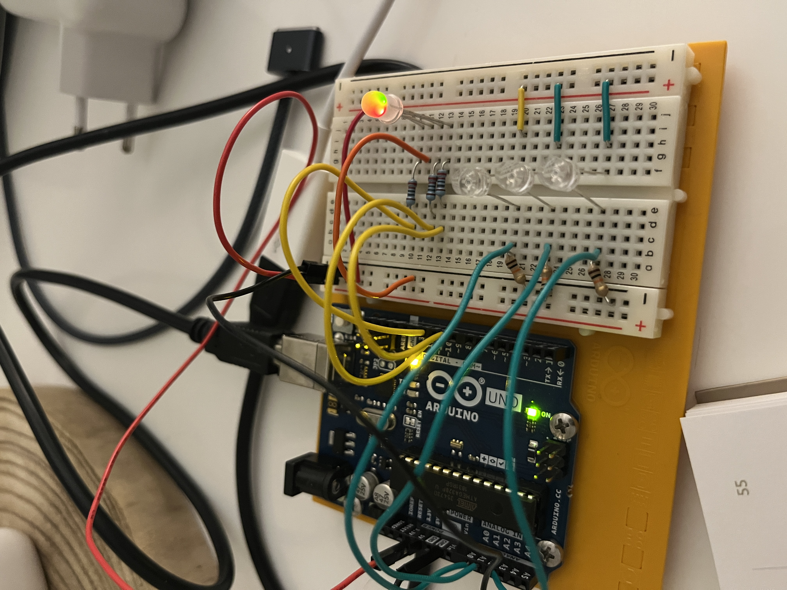

# Projet : Lampe d'Ambiance Arduino

Une lampe d'ambiance avec Arduino est un projet électronique classique qui permet de contrôler la couleur et l'intensité d'une source lumineuse à l'aide de capteurs de lumière (phototransistors) et d'une carte Arduino.

## 🛠 Matériel nécessaire (version de base)
- Carte Arduino (type Arduino Uno ou Nano)[cite: 1]
- LED RGB (à cathode ou anode commune)[cite: 1]
- 3 Phototransistors (ou photorésistances LDR) pour une variation automatique selon la lumière ambiante[cite: 1]
- Résistances adaptées[cite: 1]
- Breadboard et câbles de connexion (Jumpers)[cite: 1]

## ⚙️ Principe de fonctionnement

1. **La commande de couleur :** Les broches PWM (Pulse Width Modulation) de l'Arduino envoient un signal analogique simulé (valeurs de 0 à 255) à chaque canal de la LED RGB pour mélanger les couleurs (synthèse additive)[cite: 1].
2. **L'interaction :** 
   - Le système lit en continu la luminosité captée par les trois phototransistors sur les entrées analogiques (`A0`, `A1`, `A2`).
   - L'Arduino recalcule ces valeurs pour piloter dynamiquement les broches PWM (`9`, `10`, `11`) reliées aux canaux de la LED RGB.

## 💻 Code Source
Le code source complet de ce projet se trouve dans le fichier [`LampeAmbiance/LampeAmbiance.ino`](LampeAmbiance/LampeAmbiance.ino).
